Hello, I'm Abdul Wasay
I'm a frontend web developer based in Karachi, Pakistan. I enjoy turning ideas into fast, accessible and visually polished web experiences — from responsive websites to interactive React applications.

My main focus is React, Next.js, JavaScript and modern UI development. Alongside frontend engineering, I'm developing my backend knowledge and learning DevOps and cloud fundamentals to understand the complete path from code to deployment.
- Focused on: Responsive interfaces, reusable components, APIs and performance
- Building: Real-world projects and interactive web experiences
- Learning: MERN stack, MySQL and DevOps / cloud foundations
- Opportunities: Frontend internships, junior developer roles and collaborations
Technical toolkit
A clear view of the technologies I work with and the areas I'm developing.

Frontend development

  

Development tools & platforms

  

Other technologies & experience

REST APIs · JSON · XML · Responsive Design · UI/UX · JavaScript Validation · Shopify · Three.js · React Three Fiber
Currently learning, not claiming professional expertise: PHP, MySQL, Node.js, Express, MongoDB, Docker, Linux, CI/CD and cloud technologies.

Learning & growth
DevOps & cloud journey

I'm expanding beyond frontend development to learn how software is built, tested, deployed and maintained. This is my learning roadmap, not a list of professional DevOps certifications.
Stage	What I'm focusing on	Learning objective
Now · Fundamentals	Linux command line, Git workflows, Docker & containers	Run and package applications consistently
Learning · Automation	GitHub Actions, CI/CD, deployment workflows	Understand automated build and deployment pipelines
Next · Cloud	AWS basics (EC2, S3, IAM), networking & hosting	Learn how cloud applications are deployed
Later · Infrastructure	Kubernetes, Terraform, monitoring	Explore orchestration and infrastructure as code

Full-stack development
Alongside DevOps, I'm continuing to strengthen PHP, MySQL, REST APIs, and the Node.js + Express + MongoDB side of MERN development.

<b>What I'm aiming to build next</b>

 

- A containerized React + API project using Docker
- An automated GitHub Actions workflow for testing and deployment
- A full-stack application with authentication and database integration
- A small cloud deployment documented from setup to production

Selected projects
<table>
  <tr>
    <td width="50%" valign="top">
      <b>ERP Pathway</b>  
      A React-based platform exploring ERP learning and career pathways through a modern interface.  
      React · JavaScript · Vite  
      <a href="https://erp-pathway.vercel.app/">Live demo</a> · <a href="https://github.com/WasayWithCode/erp-pathway">Repository</a>
    </td>
    <td width="50%" valign="top">
      <b>3D Portfolio</b>  
      An interactive portfolio with animated sections and 3D web experiences.  
      React · Three.js · Tailwind CSS  
      <a href="https://3-d-portfolio-main-theta.vercel.app/">Live demo</a> · <a href="https://github.com/WasayWithCode/3D_Portfolio-main">Repository</a>
    </td>
  </tr>
  <tr>
    <td width="50%" valign="top">
      <b>Sanjalika Water Park</b>  
      A responsive multi-page website with facilities, attractions, gallery and visitor information.  
      HTML · CSS · JavaScript · Bootstrap  
      <a href="https://sanjalika-water-park-five.vercel.app/">Live demo</a> · <a href="https://github.com/WasayWithCode/Sanjalika_Water_Park">Repository</a>
    </td>
    <td width="50%" valign="top">
      <b>Student Registration Portal</b>  
      An interactive form-based app with validation, searching and student records.  
      HTML · CSS · JavaScript · jQuery  
      <a href="https://wasaywithcode.github.io/Student-Registration-Portal/">Live demo</a> · <a href="https://github.com/WasayWithCode/Student-Registration-Portal">Repository</a>
    </td>
  </tr>
</table>

More projects: <a href="https://github.com/WasayWithCode/Movixflix">Movixflix</a> · <a href="https://github.com/WasayWithCode?tab=repositories">Explore all repositories</a>
GitHub activity

<b>Animated contribution graph</b>

 

<picture>
  <source media="(prefers-color-scheme: dark)" srcset="https://raw.githubusercontent.com/WasayWithCode/WasayWithCode/output/github-contribution-grid-snake-dark.svg" />
  <source media="(prefers-color-scheme: light)" srcset="https://raw.githubusercontent.com/WasayWithCode/WasayWithCode/output/github-contribution-grid-snake.svg" />
  
</picture>

Appears after the included workflow successfully publishes its first output.

Let's build useful things for the web.

Portfolio · LinkedIn · GitHub

Abdul Wasay · Frontend developer · Always building, always learning

