<!-- GitHub profile README — Abdul Wasay | local SVGs in assets/ -->

  

  

    
    
    
  

  

## About Me

I'm **Abdul Wasay**, a frontend developer from **Karachi, Pakistan**, focused on clean interfaces, responsive websites and engaging web applications. I enjoy building with **React.js, Next.js, JavaScript and Tailwind CSS**, and turning design ideas into accessible, user-friendly experiences.

- **What I build:** Responsive websites, React interfaces and practical web projects
- **What I'm exploring:** Full-stack development, backend fundamentals and DevOps
- **What matters to me:** Clean code, usability, performance and continuous learning
- **Open to:** Junior frontend opportunities, internships and developer collaborations

## Tech Stack

### Frontend Development

<table align="center" width="100%">
  <tr>
    <td align="center" valign="middle" width="25%" style="padding: 11px 8px;">
      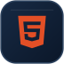 
      <b>HTML5</b>
    </td>
    <td align="center" valign="middle" width="25%" style="padding: 11px 8px;">
      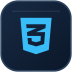 
      <b>CSS3</b>
    </td>
    <td align="center" valign="middle" width="25%" style="padding: 11px 8px;">
       
      <b>JavaScript</b>
    </td>
    <td align="center" valign="middle" width="25%" style="padding: 11px 8px;">
      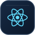 
      <b>React.js</b>
    </td>
  </tr>
  <tr>
    <td align="center" valign="middle" width="25%" style="padding: 11px 8px;">
       
      <b>Next.js</b>
    </td>
    <td align="center" valign="middle" width="25%" style="padding: 11px 8px;">
       
      <b>Tailwind CSS</b>
    </td>
    <td align="center" valign="middle" width="25%" style="padding: 11px 8px;">
       
      <b>Bootstrap</b>
    </td>
    <td align="center" valign="middle" width="25%" style="padding: 11px 8px;">
       
      <b>jQuery</b>
    </td>
  </tr>
</table>

### Tools & Platforms

<table align="center" width="100%">
  <tr>
    <td align="center" valign="middle" width="25%" style="padding: 11px 8px;">
      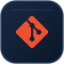 
      <b>Git</b>
    </td>
    <td align="center" valign="middle" width="25%" style="padding: 11px 8px;">
       
      <b>GitHub</b>
    </td>
    <td align="center" valign="middle" width="25%" style="padding: 11px 8px;">
      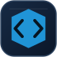 
      <b>VS Code</b>
    </td>
    <td align="center" valign="middle" width="25%" style="padding: 11px 8px;">
       
      <b>Vercel</b>
    </td>
  </tr>
  <tr>
    <td align="center" valign="middle" width="25%" style="padding: 11px 8px;">
       
      <b>WordPress</b>
    </td>
    <td align="center" valign="middle" width="25%" style="padding: 11px 8px;">
       
      <b>Figma</b>
    </td>
    <td align="center" valign="middle" width="25%" style="padding: 11px 8px;">
       
      <b>Docker</b>
    </td>
    <td align="center" valign="middle" width="25%" style="padding: 11px 8px;">
       
      <b>Postman</b>
    </td>
  </tr>
</table>

**Also work with:** REST APIs · JSON · XML · Responsive Design · UI/UX · Three.js · React Three Fiber · Shopify

## Currently Learning

I'm steadily moving toward **full-stack development** while exploring the fundamentals of **DevOps, cloud infrastructure and automation**. These are learning goals, not claims of professional expertise.

### Backend & Full Stack

<table align="center" width="100%">
  <tr>
    <td align="center" valign="middle" width="25%" style="padding: 11px 8px;">
       
      <b>PHP</b>
    </td>
    <td align="center" valign="middle" width="25%" style="padding: 11px 8px;">
      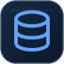 
      <b>MySQL</b>
    </td>
    <td align="center" valign="middle" width="25%" style="padding: 11px 8px;">
      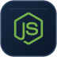 
      <b>Node.js</b>
    </td>
    <td align="center" valign="middle" width="25%" style="padding: 11px 8px;">
       
      <b>Express.js</b>
    </td>
  </tr>
  <tr>
    <td align="center" valign="middle" width="25%" style="padding: 11px 8px;">
       
      <b>MongoDB</b>
    </td>
    <td align="center" valign="middle" width="25%" style="padding: 11px 8px;">
      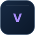 
      <b>Vite</b>
    </td>
    <td width="25%"></td>
    <td width="25%"></td>
  </tr>
</table>

### DevOps & Cloud Engineering

  

- **Current foundations:** Linux, Docker, Git workflows and container basics
- **Automation:** GitHub Actions, CI/CD pipelines and deployment workflows
- **Next on my roadmap:** AWS fundamentals, cloud hosting and networking
- **Long-term exploration:** Kubernetes, Terraform and application monitoring

  &nbsp;&nbsp;
  &nbsp;&nbsp;
  &nbsp;&nbsp;
  &nbsp;&nbsp;
  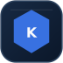&nbsp;&nbsp;
  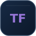

## Featured Projects

<table width="100%">
  <tr>
    <td width="50%" valign="top">
      <h3>ERP Pathway</h3>
      
ERP learning and career guidance concept built with React and a modern user interface.

      
React · Vite · JavaScript

      <a href="https://erp-pathway.vercel.app/">Live Demo</a> · <a href="https://github.com/WasayWithCode/erp-pathway">Source Code</a>
    </td>
    <td width="50%" valign="top">
      <h3>Interactive 3D Portfolio</h3>
      
Personal portfolio featuring 3D graphics, polished interactions and responsive pages.

      
React · Three.js · Tailwind CSS

      <a href="https://3-d-portfolio-main-theta.vercel.app/">Live Demo</a> · <a href="https://github.com/WasayWithCode/3D_Portfolio-main">Source Code</a>
    </td>
  </tr>
  <tr>
    <td width="50%" valign="top">
      <h3>Sanjalika Water Park</h3>
      
Multi-page visitor website featuring attractions, facilities, gallery and contact pages.

      
HTML · CSS · JavaScript · Bootstrap

      <a href="https://sanjalika-water-park-five.vercel.app/">Live Demo</a> · <a href="https://github.com/WasayWithCode/Sanjalika_Water_Park">Source Code</a>
    </td>
    <td width="50%" valign="top">
      <h3>Student Registration Portal</h3>
      
Student registration interface with validation, search and interactive record management.

      
HTML · CSS · JavaScript · jQuery

      <a href="https://wasaywithcode.github.io/Student-Registration-Portal/">Live Demo</a> · <a href="https://github.com/WasayWithCode/Student-Registration-Portal">Source Code</a>
    </td>
  </tr>
</table>

  <a href="https://github.com/WasayWithCode/Movixflix">Movixflix</a> · <a href="https://github.com/WasayWithCode?tab=repositories">All Repositories</a>

## GitHub Activity

  
  

### Contributions

  <picture>
    <source media="(prefers-color-scheme: dark)" srcset="https://raw.githubusercontent.com/WasayWithCode/WasayWithCode/output/github-contribution-grid-snake-dark.svg" />
    <source media="(prefers-color-scheme: light)" srcset="https://raw.githubusercontent.com/WasayWithCode/WasayWithCode/output/github-contribution-grid-snake.svg" />
    
  </picture>

## Let's Connect

I'm open to working on creative web experiences and learning with other developers.

  <a href="https://3-d-portfolio-main-theta.vercel.app/">Portfolio</a> · <a href="https://www.linkedin.com/in/abdulwasay-frontend/">LinkedIn</a> · <a href="https://github.com/WasayWithCode">GitHub</a>
   
  

